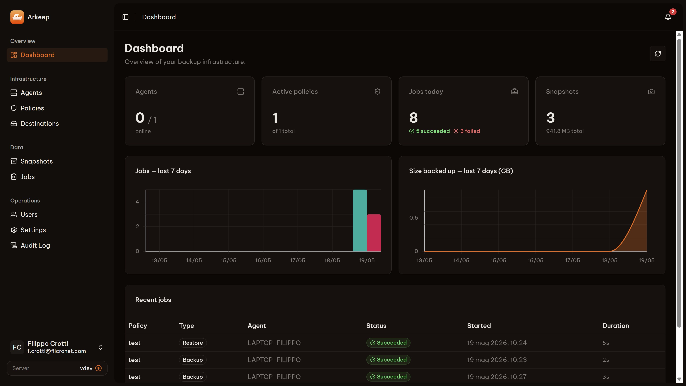

# Arkeep server

> Your infra's Ark — back up everything, keep it yours.

Open-source, self-hosted control for [Restic](https://restic.net/) and [Rclone](https://rclone.org/): one server, a lightweight agent on every machine, one dashboard.

This image runs the **Arkeep server**: the web interface, the REST API and the gRPC endpoint agents connect to. Pair it with [`arkeepio/arkeep-agent`](https://hub.docker.com/r/arkeepio/arkeep-agent) on each machine you back up.

**[Website](https://arkeep.io)** · **[Documentation](https://arkeep.io/docs/)** · **[Quickstart](https://arkeep.io/docs/quickstart/)** · **[GitHub](https://github.com/arkeep-io/arkeep)**



## Quick start

You need Docker with Docker Compose.

```bash
mkdir arkeep && cd arkeep
curl -O https://raw.githubusercontent.com/arkeep-io/arkeep/main/deploy/docker/docker-compose.yml
curl -o .env https://raw.githubusercontent.com/arkeep-io/arkeep/main/deploy/docker/.env.example
sed -i "s|^ARKEEP_SECRET_KEY=.*|ARKEEP_SECRET_KEY=$(openssl rand -hex 32)|" .env
sed -i "s|^ARKEEP_AGENT_SECRET=.*|ARKEEP_AGENT_SECRET=$(openssl rand -hex 24)|" .env
docker compose up -d
```

Open `http://localhost:8080` and create the admin account. The setup page stays open for 15 minutes after the server starts.

Keep `.env` safe: `ARKEEP_SECRET_KEY` encrypts every credential Arkeep stores and must never change once set.

Reverse proxy, PostgreSQL, Kubernetes and standalone binaries: see [Installation](https://arkeep.io/docs/installation/docker-compose/).

## Tags

| Tag | Meaning |
|---|---|
| `vX.Y.Z` | A specific release. **Use this in production** and upgrade on purpose. |
| `latest` | The most recent release. |

Every tag is a multi-platform image for `linux/amd64` and `linux/arm64`. The same images are published on GitHub Container Registry as `ghcr.io/arkeep-io/arkeep-server`.

Database migrations run automatically when the server starts: back up the `/var/lib/arkeep` volume before upgrading.

## Ports and volumes

| | |
|---|---|
| `8080/tcp` | Web interface and REST API |
| `9090/tcp` | gRPC, used by agents (outbound from the agent, mTLS by default) |
| `/var/lib/arkeep` | SQLite database, auto-generated CA and certificates. Persist it. |

The container runs as the unprivileged `arkeep` user.

## Main environment variables

| Variable | Required | Description |
|---|---|---|
| `ARKEEP_SECRET_KEY` | yes | Master key encrypting stored credentials. `openssl rand -hex 32` |
| `ARKEEP_AGENT_SECRET` | yes | Shared secret agents use to enroll. `openssl rand -hex 24` |
| `ARKEEP_BASE_URL` | no | Public URL of the server, used in email links (password reset) |
| `ARKEEP_DB_DRIVER` / `ARKEEP_DB_DSN` | no | `sqlite` (default) or `postgres`, and its connection string |
| `ARKEEP_SECURE_COOKIES` | no | `true` when served over HTTPS behind a reverse proxy |
| `ARKEEP_TELEMETRY` | no | `false` turns off the anonymous daily usage ping |

Every option is in the [server configuration reference](https://arkeep.io/docs/reference/server-config/).

## Security

Images are built by GoReleaser in GitHub Actions from a digest-pinned Alpine base and scanned with Trivy. Report vulnerabilities privately as described in [SECURITY.md](https://github.com/arkeep-io/arkeep/blob/main/SECURITY.md).

## License

[Apache-2.0](https://github.com/arkeep-io/arkeep/blob/main/LICENSE)
